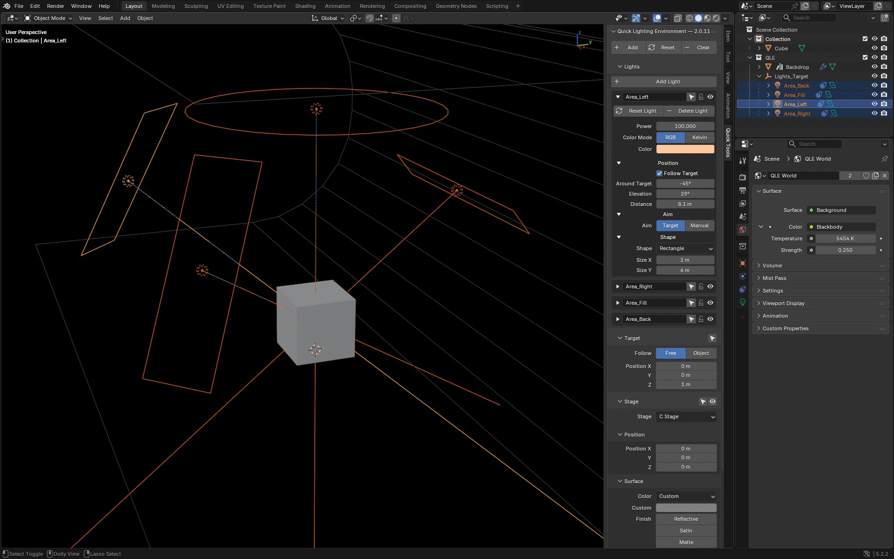

# Blender QLE

**Quick Lighting Environment adds a useful studio-style lighting setup to your Blender scene in one click.**

## Requirements

- **Blender 4.5** or newer
- **EEVEE** or **Cycles**

QLE appears under **3D Viewport > Sidebar > Quick Tools > Quick Lighting Environment**.

## Installation

Download the latest ZIP from [Releases](https://github.com/don1138/blender-qle/releases), then drag it onto Blender and click **Install**. Do not unzip it first.

## Usage

1. Open the **Quick Tools** tab in the 3D Viewport Sidebar.
2. Click **Add**.
3. Place your subject near the global origin (`0, 0, 0`) and adjust the **Lights**, **Target**, **Stage**, or **World** as needed.

The default environment contains:

- Four **Area** lights based on the classic QLE arrangement
- A shared target named **Lights_Target**
- A C-shaped backdrop called **C Stage**
- A **QLE World** set to `5454 K` with **Strength** of `0.25`

## Panel Controls

### 🦐 Main Actions

- **Add** creates a new lighting collection. If you have deleted the **Stage**, **Lights_Target**, or any lights, clicking **Add** again will restore the missing components.
- **Reset** reverts everything in the collection (except protected lights) back to factory settings. If you want a light to remain unaffected by **Reset**, click the **Protect** icon (padlock) next to its name.
- **Clear** deletes the entire **QLE** collection (except for protected lights) and restores the previous **World**.

Again, protected lights survive **Reset** and **Clear**.

### 🦐 Lights

Each QLE light can be adjusted in the QLE panel, or by using the standard Blender panels and controls. Lights can be moved manually, and new coordinates will be updated in the QLE panel.

The default setup includes four lights. Click the **Add Light** button to add as many more as you want.

Each light gets its own sub-panel and set of controls. Most are obvious, but here are some notes.

#### 🚡 Title Bar

- **Name** (editable)
- **Select** icon
- **Protect** icon — Prevents the light from being reset or cleared by the **Main Actions** buttons.
- **Hide/Disable** icon

#### 🚡 Color Mode

- **RGB** — Set the light color using the **Color** field.
- **Kelvin** — Set the Blackbody value of the light, or select from a dropdown of common **Temperature** presets.
- **RGB** and **Kelvin** remember their independent values when you switch between them.

The four classic lights begin in RGB mode so their established appearance is preserved. Their preloaded Kelvin values are:

| Light          | HEX     | Kelvin  |
| -------------- | ------- | ------: |
| **Area_Left**  | `#FFC99D` | `3800 K`  |
| **Area_Right** | `#ABC6FF` | `20,000 K` |
| **Area_Fill**  | `#FFEDDD` | `5454 K`  |
| **Area_Back**  | `#FFEDDD` | `5454 K`  |
| **New Lights** | `#FFFFFF` | `6500 K`  |

#### 🚡 Position

- **Follow Target** — As you can see in the **Outliner**, all lights are parented to the **Lights_Target** by default. Disable this checkbox and the light will remain in its current position if the **Lights_Target** is moved.
- **Around Target** — Moves the light around the `Z` axis of the **Lights_Target**.

#### 🚡 Aim

- Lights default to pointing at **Lights_Target**. Switch from **Target** to **Manual**, and you can point the light anywhere you want.

### 🦐 Target

#### 🚡 Follow

- **Free** — Position the **Lights_Target** anywhere in your scene.
- **Object** — Set the **Lights_Target** to match and follow the same XYZ coordinates as any scene object.

### 🦐 Stage

Available Stage types are:

- **C Stage**
- **L Stage**
- **Flat Background**
- **Floor**
- **None**

#### 🚡 Surface

- Default **Stage** color is `#808080`.
- Choose a color preset from the **Color** menu, or set a custom value using the **Custom** color picker.
- **Finish** — Set the **Roughness** of the Stage material. Default roughness value is `1.0`.

### 🦐 World

- The **QLE World** default color is set to `5454 K` at **Strength** `0.25`.
- The World light intentionally evens out the backdrop and reduces very dark areas.
- For a more traditional studio setup, reduce the **QLE World** **Strength** to `0` and increase the **Power** of the **Area_Fill** light.

## Default Lights

### All Lights

### QLE World

### Area Right

### Area Left

### Area Back

### Area Fill

## Note on Shadows

You may want to angle some bounce cards on the ground in front of your model to lessen the bottom shadows. I use a basic mesh plane with `Properties > Object Properties > Visibility > Ray Visibility > Camera` and `Glossy` turned off.

## Mentions

- [Architecture Topics: 10 Best Free Blender ADD-ONS!](https://www.youtube.com/watch?v=QJnB6LRtpxA&t=173s)
- [Architecture Topics: Best Glass Material in Blender (Tutorial)](https://www.youtube.com/watch?v=MzIreMJRhqk)
- [Jinxxy.com](https://jinxxy.com/market/browse?search_query=Quick+Metal+Materials&listing=3449245791745476435)
- [Architecture Topics: BEST Free Lighting Addons for Blender 2024](https://youtu.be/nojuev0F1_w)
- [Quick Lighting Environment (QLE) Addon for Blender | Free Studio Light Just ONE CLICK | Graphskill](https://www.youtube.com/watch?v=8RnYfONirUQ)

  

  
  
   
  

