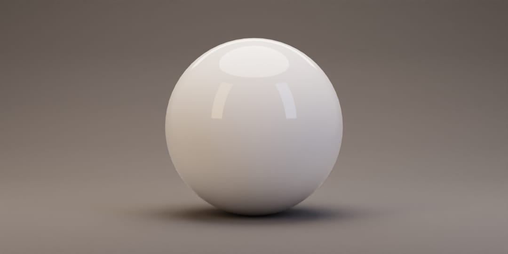
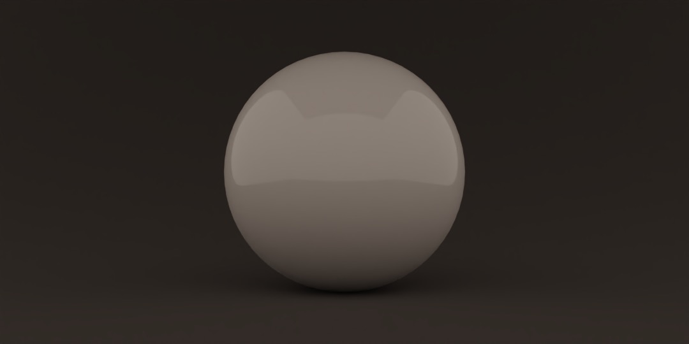
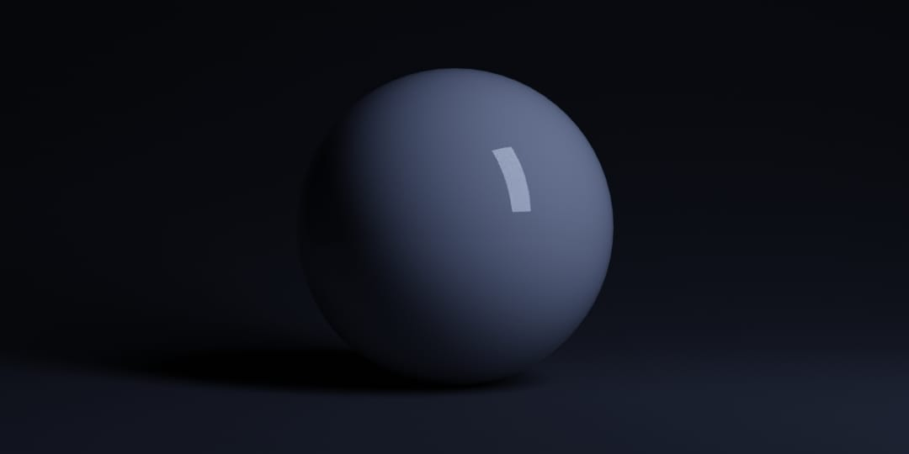
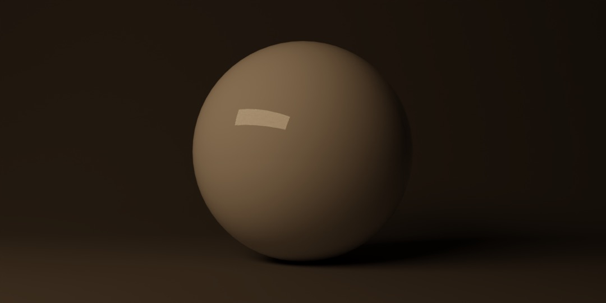
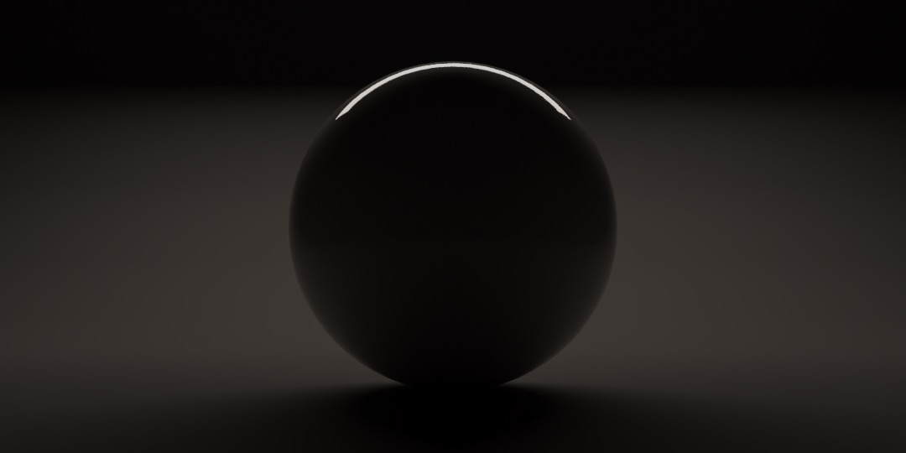
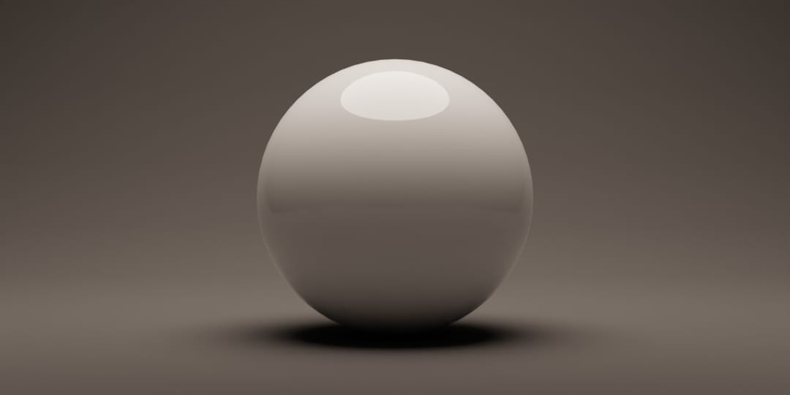

# Blender QLE

**Quick Lighting Environment adds a useful studio-style lighting setup to your Blender scene in one click.**

QLE 2.0 keeps the familiar four-light result while adding direct controls for light placement, aiming, color temperature, the Stage, and the World in the 3D Viewport Sidebar.

<!-- Add a current QLE 2.0 Quick Tools panel screenshot here before release. -->

## Requirements

- Blender 4.5 or newer
- EEVEE or Cycles

QLE appears under **3D Viewport > Sidebar > Quick Tools > Quick Lighting Environment**.

## Installation

1. Download the QLE extension ZIP from [Releases](https://github.com/don1138/blender-qle/releases).
2. In Blender, open **Edit > Preferences > Extensions**.
3. Choose **Install from Disk** and select the downloaded ZIP.
4. Enable **QLE (Quick Lighting Environment)** if Blender does not enable it automatically.

Install the ZIP directly. Do not extract it first.

## Quick Start

1. Open the **Quick Tools** tab in the 3D Viewport Sidebar.
2. Click **Add**.
3. Place your subject near the origin and adjust the Lights, Target, Stage, or World as needed.

The default environment contains:

- Four Area lights based on the classic QLE arrangement
- A shared lighting Target
- A C Backdrop Stage
- A QLE World set to 5454 K at Strength 0.25

Clicking **Add** again repairs missing QLE parts without resetting existing adjustments.

## Main Actions

- **Add** creates QLE or restores required parts that are missing.
- **Reset** restores the unprotected default lights, Target, Stage, and World. Added unprotected lights and their adjustments are removed. Confirmation is required.
- **Clear** removes unprotected QLE content and restores the World that was active before QLE. Confirmation is required.

Protected lights survive Reset and Clear.

## Adjustments

### Lights

Each QLE light can be renamed, selected, enabled or disabled, protected, reset, or deleted. You can also add more Area lights.

Light controls include:

- Power
- RGB or Kelvin color mode
- Position around the light's Target
- Target or Manual Aim
- Area-light Shape and Size

The four classic lights begin in RGB mode so their established appearance is preserved. Their preloaded Kelvin values are:

| Light | Kelvin |
| --- | ---: |
| Area Right | 20000 K |
| Area Left | 3800 K |
| Area Fill | 5454 K |
| Area Back | 5454 K |

New lights begin as white RGB lights with 6500 K preloaded. RGB and Kelvin remember their values independently.

### Position and Aim

Position controls describe where a light sits around its Target. You can also move the light normally in the 3D Viewport; the controls update to match.

**Follow Target** determines whether moving the Target also carries the light. **Aim** independently chooses automatic Target aiming or manual rotation.

### Target

The shared Target can remain Free or follow another scene object. Choosing an object snaps the Target to that object's origin, while Position provides an editable offset.

### Stage

Available Stage types are:

- C Backdrop
- L Backdrop
- Flat Background
- Floor
- None

Stage controls include Position, visibility, 17 Studio Colors, a Custom color, Reflective/Satin/Matte finishes, and Roughness. Switching Stage types preserves the current surface and visibility settings.

The original C Backdrop keeps its legacy Diffuse material until you explicitly change Finish or Roughness. That edit converts the surface to Principled; Reset restores the original material.

### World

The QLE World provides Strength plus independent RGB and Kelvin modes. Switching modes preserves the saved value in each mode, and Kelvin is not tinted by the saved RGB color.

## Protecting Lights

**Protect** keeps a managed light and its private Target outside the environment that Reset and Clear replace. Protected lights remain editable through QLE.

**Reset Light** restores one light's default settings and position while preserving its name and protection state.

## Existing QLE Scenes

Click **Add** to adopt a recognizable QLE setup and add the persistent ownership information required by QLE 2.0. Existing light appearance and unrelated constraints are preserved where possible.

Legacy QLE versions did not store the World that existed before QLE. If that history is unavailable, QLE reports it and creates a fallback World during Clear rather than guessing which World to restore.

## Default Lighting Breakdown

These renders isolate each part of the classic QLE setup so you can see what it contributes. They demonstrate the default lighting result rather than the current QLE 2.0 interface.

### All Lights

### QLE World

### Area Right

### Area Left

### Area Back

### Area Fill

## Lighting Notes

- The World light intentionally evens out the backdrop and reduces very dark areas.
- For a more traditional studio setup, reduce the QLE World Strength to `0` and increase Area Fill Power.
- A simple mesh plane can work as a bounce card in front of the subject. Hide it from the Camera and glossy reflections if it should affect only the lighting.

## Help and Project Information

- Report a problem through [GitHub Issues](https://github.com/don1138/blender-qle/issues).
- See [CHANGELOG.md](CHANGELOG.md) for release history.
- QLE is available under the [GNU General Public License v3.0](LICENSE).

## Mentions

- [Architecture Topics: 10 Best Free Blender ADD-ONS!](https://www.youtube.com/watch?v=QJnB6LRtpxA&t=173s)
- [Architecture Topics: Best Glass Material in Blender (Tutorial)](https://www.youtube.com/watch?v=MzIreMJRhqk)
- [Jinxxy.com](https://jinxxy.com/market/browse?search_query=Quick+Metal+Materials&listing=3449245791745476435)
- [Architecture Topics: BEST Free Lighting Addons for Blender 2024](https://youtu.be/nojuev0F1_w)
- [Quick Lighting Environment (QLE) Addon for Blender | Free Studio Light Just ONE CLICK | Graphskill](https://www.youtube.com/watch?v=8RnYfONirUQ)

  

  
  
   
  

